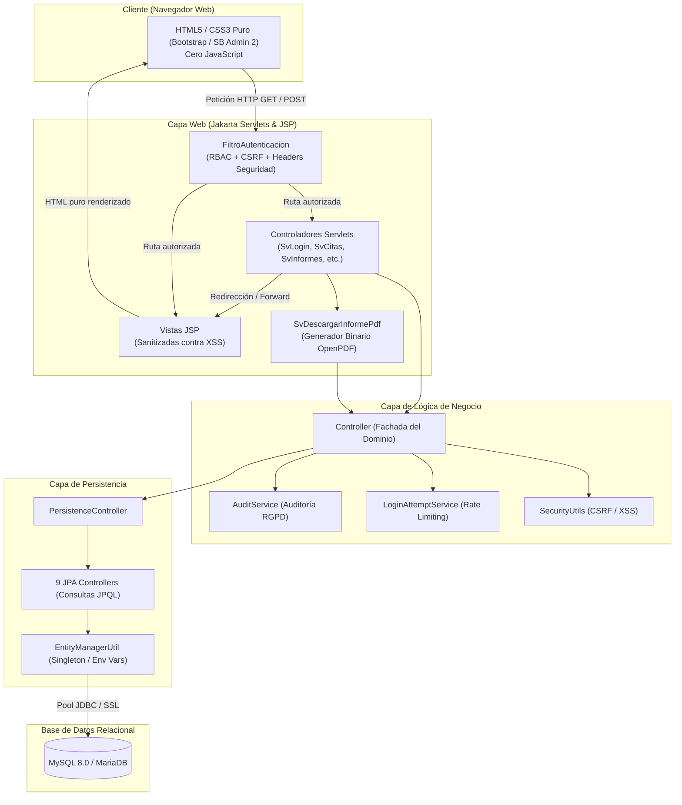
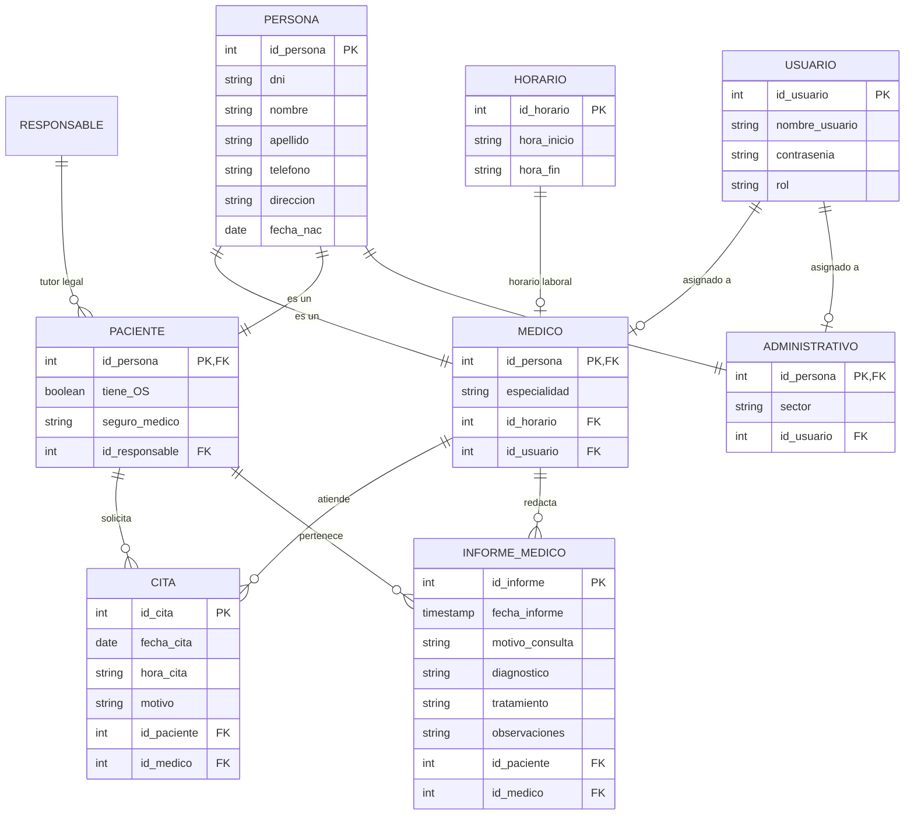

# 🏥 Sistema de Gestión Clínica - Clínica Médica

[](https://github.com/)
[](https://www.oracle.com/java/)
[](https://jakarta.ee/)
[](https://hibernate.org/)
[](https://www.mysql.com/)
[-success.svg)](https://developer.mozilla.org/)
[](https://owasp.org/)
[](https://www.aepd.es/)

---

## 📌 Descripción General

**Clínica Médica** es una plataforma web corporativa integral diseñada para la gestión clínica, administrativa y facultativa de centros de salud, clínicas privadas y policlínicas. Desarrollada sobre la plataforma **Jakarta EE** con persistencia relacional **JPA / Hibernate**, su arquitectura prioriza la **seguridad integral (OWASP Top 10)**, el cumplimiento normativo en protección de datos de salud (**RGPD / LOPDGDD**) y una estricta **filosofía Cero-JavaScript (Zero-JS)** donde el 100% de los flujos, formularios, filtros y calendarios son procesados y renderizados de forma nativa en el servidor.

---

## 🚀 Características Principales

### 👨‍⚕️ 1. Módulo Facultativo y Clínico
* **Historial Clínico Integral**: Visualización unificada por paciente con antecedentes, historial de citas y todos sus informes médicos asociados.
* **Emisión de Informes Médicos Oficiales**: Registro de motivo de consulta, juicio diagnóstico, prescripción terapéutica y observaciones de seguimiento.
* **Exportación y Descarga en PDF**: Generación binaria en memoria de documentos clínicos oficiales en formato PDF con membrete oficial, metadatos y aviso de confidencialidad, utilizando **OpenPDF**.
* **Gestión de Agenda Personal**: Visualización prioritaria de las citas agendadas asignadas al facultativo conectado.

### 📅 2. Agenda y Calendario Server-Side (Zero-JS)
* **Calendario Mensual 100% Nativo**: Cuadrícula interactiva generada en el servidor (sin librerías JavaScript pesadas ni CDNs externos).
* **Navegación Temporal**: Desplazamiento fluido entre meses (*« Anterior*, *Siguiente »*, *Mes Actual*) mediante parámetros HTTP GET limpios.
* **Filtrado Cruzado**: Filtrado simultáneo por médico y por paciente mediante formularios HTML estándar.
* **Acciones Directas**: Acceso en un clic a la historia clínica del paciente, redacción de informe, alta rápida de cita para un día determinado (`+`) y cancelación con protección CSRF.
* **Control de Franja Horaria**: Las citas solo pueden asignarse estrictamente dentro del horario laboral configurado para cada facultativo.

### 👥 3. Gestión de Pacientes, Médicos y Personal Administrativo
* **Pacientes**: Alta, gestión clínica, filtrado predictivo y asignación de tutor legal / responsable para pacientes menores de edad (< 18 años).
* **Médicos**: Alta vinculada a usuarios del sistema y configuración de horarios de atención (hora de inicio y fin). Edición y baja protegidas por rol administrador.
* **Administrativos**: Gestión de personal de recepción y secretaría médica con asignación de sectores funcionales.
* **Usuarios y Roles**: Control de credenciales de acceso con tres roles diferenciados (`ADMINISTRADOR`, `MEDICO`, `RECEPCIONISTA`).

### 🛡️ 4. Seguridad Avanzada y Cumplimiento Legal
* **Protección Anti-Fuerza Bruta**: Rate limiter concurrente que bloquea la cuenta/IP tras 5 intentos fallidos durante 15 minutos.
* **Protección contra Session Fixation**: Regeneración obligatoria de identificador de sesión con `request.changeSessionId()` tras autenticación exitosa.
* **Protección CSRF**: Implementación del patrón *Synchronizer Token Pattern* con tokens criptográficos `SecureRandom` y validación en tiempo constante contra *timing attacks*.
* **Sanitización XSS**: Neutralización sistemática de inyecciones HTML en todas las vistas JSP.
* **Auditoría de Salud (RGPD Art. 9 / LOPDGDD)**: Trazabilidad inmutable de cada acceso a historiales, generación de informes y descarga de PDFs.
* **Variables de Entorno para Producción**: Desacoplamiento de credenciales de base de datos vía `DB_URL`, `DB_USER` y `DB_PASSWORD`.

---

## 🏛️ Arquitectura del Sistema

El proyecto sigue una arquitectura desacoplada en tres capas según el patrón **Modelo-Vista-Controlador (MVC)**:



---

## 💻 Pila Tecnológica

| Componente | Tecnología | Versión | Propósito |
| :--- | :--- | :--- | :--- |
| **Lenguaje** | Java (JDK) | 17+ / 21 / 27 | Lenguaje principal de desarrollo empresarial |
| **Plataforma Web** | Jakarta EE (Servlet API) | 6.1.0 | Gestión de peticiones HTTP, sesiones y filtros |
| **Motor de Plantillas** | JSP (Jakarta Server Pages) | 3.1.0 | Renderizado de vistas server-side |
| **Persistencia** | Hibernate ORM / JPA | 7.4.5.Final | Mapeo objeto-relacional y consultas JPQL |
| **Base de Datos** | MySQL Server | 8.0+ | Almacenamiento relacional de datos clínicos |
| **Driver BD** | MySQL Connector/J | 26.10.0 | Conectividad JDBC optimizada |
| **Generación PDF** | OpenPDF | 2.0.3 | Generación de informes clínicos oficiales en memoria |
| **Criptografía** | jBCrypt | 0.4 | Hashing robusto de contraseñas |
| **Frontend** | HTML5 / CSS3 / SB Admin 2 | - | Interfaz administrativa limpia y responsiva (Zero-JS) |
| **Construcción** | Apache Maven | 3.9+ | Gestión de dependencias y ciclo de vida de compilación |
| **Contenedor** | Apache Tomcat | 9.0 / 10.1 | Servidor de aplicaciones web de producción |

---

## 🗄️ Modelo de Base de Datos Relacional

El modelo de datos garantiza la integridad referencial y el cumplimiento normativo médico:



---

## ⚙️ Instalación y Puesta en Marcha Local

### Prerrequisitos
- **Java Development Kit (JDK)**: Versión 17 o superior instalada (`java -version`).
- **MySQL Server**: Versión 8.0 o superior en ejecución en el puerto 3306.
- **Git**: Para clonar el repositorio.

### 1. Clonar el repositorio
```bash
git clone https://github.com/tu-usuario/ClinicaMedica.git
cd ClinicaMedica
```

### 2. Configurar la Base de Datos
Crea una base de datos en MySQL:
```sql
CREATE DATABASE clinica_medica CHARACTER SET utf8mb4 COLLATE utf8mb4_unicode_ci;
```

Configura tus credenciales locales en [`src/main/resources/META-INF/persistence.xml`](file:///Volumes/Datos/IDEA/ClinicaMedica/src/main/resources/META-INF/persistence.xml) o mediante variables de entorno (recomendado):
```bash
export DB_URL="jdbc:mysql://localhost:3306/clinica_medica?serverTimezone=UTC"
export DB_USER="root"
export DB_PASSWORD="tu_password_local"
```

### 3. Compilar el proyecto con Maven Wrapper
```bash
./mvnw clean package -DskipTests
```

El archivo WAR generado se ubicará en `target/ClinicaMedica-1.0-SNAPSHOT.war`.

### 4. Ejecución en Servidor Local (IntelliJ IDEA o Tomcat)
- En **IntelliJ IDEA**: Abre el proyecto, crea una configuración de ejecución de tipo **Tomcat Server (Local)**, añade el artefacto `ClinicaMedica:war exploded` y pulsa **Run**.
- Abre tu navegador en: `http://localhost:8080/`

---

## 🐳 Despliegue en Producción con Docker y Docker Compose

El proyecto está preparado para desplegarse de manera contenerizada y aislada en menos de dos minutos.

### `docker-compose.yml`
```yaml
version: '3.8'

services:
  db:
    image: mysql:8.0
    container_name: clinica-mysql
    restart: always
    environment:
      MYSQL_ROOT_PASSWORD: RootPasswordSeguro2026!
      MYSQL_DATABASE: clinica_medica
      MYSQL_USER: clinica_user
      MYSQL_PASSWORD: AppPasswordSeguro2026!
    volumes:
      - mysql_data:/var/lib/mysql
    networks:
      - clinica-network

  app:
    build: .
    container_name: clinica-tomcat
    restart: always
    depends_on:
      - db
    environment:
      DB_URL: "jdbc:mysql://db:3306/clinica_medica?serverTimezone=UTC&useSSL=false"
      DB_USER: "clinica_user"
      DB_PASSWORD: "AppPasswordSeguro2026!"
      HIBERNATE_HBM2DDL_AUTO: "update"
    ports:
      - "127.0.0.1:8080:8080"
    networks:
      - clinica-network

networks:
  clinica-network:
    driver: bridge

volumes:
  mysql_data:
```

Para levantar la infraestructura:
```bash
docker compose up -d --build
```

---

## 🔐 Matriz de Seguridad y Cumplimiento Normativo

| Riesgo / Amenaza | Mecanismo de Defensa Implementado | Componente |
| :--- | :--- | :--- |
| **A01: Broken Access Control** | Control de acceso granular por roles (`ADMINISTRADOR`, `MEDICO`, `RECEPCIONISTA`) y normalización de rutas contra *path traversal*. | [`FiltroAutenticacion.java`](file:///Volumes/Datos/IDEA/ClinicaMedica/src/main/java/filtros/FiltroAutenticacion.java) |
| **A02: Cryptographic Failures** | Credenciales de base de datos desacopladas en variables de entorno, cookies `HttpOnly`, y soporte HTTPS/TLS. | [`EntityManagerUtil.java`](file:///Volumes/Datos/IDEA/ClinicaMedica/src/main/java/persistence/EntityManagerUtil.java) |
| **A03: Injection** | Consultas parametrizadas en JPQL / JPA y escape sistemático de salida HTML en todas las vistas JSP. | [`SecurityUtils.java`](file:///Volumes/Datos/IDEA/ClinicaMedica/src/main/java/Logica/SecurityUtils.java) |
| **A04: Insecure Design** | Rate limiting anti-fuerza bruta: bloqueo de 15 minutos tras 5 intentos fallidos consecutivos por usuario e IP. | [`LoginAttemptService.java`](file:///Volumes/Datos/IDEA/ClinicaMedica/src/main/java/Logica/LoginAttemptService.java) |
| **A05: Security Misconfiguration** | Páginas de error genéricas (404, 500) que suprimen *stack traces* e información interna; `show_sql=false`. | [`web.xml`](file:///Volumes/Datos/IDEA/ClinicaMedica/src/main/webapp/WEB-INF/web.xml) |
| **A07: Identification Failures** | Prevención de *Session Fixation* mediante `request.changeSessionId()` en el login; caducidad a los 30 min. | [`SvLogin.java`](file:///Volumes/Datos/IDEA/ClinicaMedica/src/main/java/servlets/SvLogin.java) |
| **A08: Software Integrity (CSRF)** | *Synchronizer Token Pattern* con tokens criptográficos de 32 bytes y validación en tiempo constante. | [`SecurityUtils.java`](file:///Volumes/Datos/IDEA/ClinicaMedica/src/main/java/Logica/SecurityUtils.java) |
| **A09: Logging & RGPD** | Trazabilidad inmutable de accesos a historias clínicas y descargas de PDFs con fines legales (**RGPD Art. 9**). | [`AuditService.java`](file:///Volumes/Datos/IDEA/ClinicaMedica/src/main/java/Logica/AuditService.java) |

---

## 📁 Estructura del Repositorio

```

ClinicaMedica/
├── src/
│   ├── main/
│   │   ├── java/
│   │   │   ├── Logica/                # Entidades del dominio, fachada Controller y utilidades de seguridad
│   │   │   │   ├── Persona.java, Medico.java, Paciente.java, Administrativo.java
│   │   │   │   ├── Cita.java, Horario.java, InformeMedico.java, Usuario.java
│   │   │   │   ├── Controller.java
│   │   │   │   ├── SecurityUtils.java (CSRF & XSS)
│   │   │   │   ├── LoginAttemptService.java (Rate Limiter)
│   │   │   │   └── AuditService.java (Auditoría RGPD)
│   │   │   ├── persistence/           # Controladores JPA y Singleton EntityManagerFactory
│   │   │   │   ├── PersistenceController.java
│   │   │   │   ├── EntityManagerUtil.java
│   │   │   │   └── *JpaController.java (9 controladores JPA)
│   │   │   ├── filtros/               # Filtros de interceptación HTTP y autorización
│   │   │   │   └── FiltroAutenticacion.java
│   │   │   └── servlets/              # Controladores Web (18 Servlets HTTP)
│   │   │       ├── SvLogin.java, SvLogout.java
│   │   │       ├── SvCitas.java, SvNuevaCita.java, SvEliminarCita.java
│   │   │       ├── SvMedicos.java, SvEditarMedico.java, SvEliminarMedico.java
│   │   │       ├── SvPacientes.java, SvEliminarPaciente.java
│   │   │       ├── SvAdministrativos.java, SvEditarAdministrativo.java, SvEliminarAdministrativo.java
│   │   │       ├── SvInformes.java, SvVerInforme.java, SvGenerarInforme.java, SvHistorialPaciente.java
│   │   │       └── SvDescargarInformePdf.java
│   │   ├── resources/
│   │   │   └── META-INF/persistence.xml
│   │   └── webapp/                    # Vistas JSP, estilos CSS y páginas de error
│   │       ├── WEB-INF/web.xml
│   │       ├── components/ (header.jsp, body1.jsp, body2.jsp)
│   │       ├── calendario-citas.jsp (Calendario Server-Side Zero-JS)
│   │       ├── historial-paciente.jsp, generar-informe.jsp, ver-informe.jsp
│   │       ├── ver-citas.jsp, alta-cita.jsp
│   │       ├── ver-medicos.jsp, alta-medico.jsp, editar-medico.jsp
│   │       ├── ver-pacientes.jsp, alta-paciente.jsp
│   │       ├── ver-administrativos.jsp, alta-administrativo.jsp, editar-administrativo.jsp
│   │       ├── ver-usuarios.jsp, alta-usuario.jsp, editar-usuario.jsp
│   │       └── error-404.jsp, error-500.jsp, sin-permiso.jsp, login.jsp
│   └── test/
├── pom.xml                            # Configuración de dependencias Maven
└── README.md                          # Este archivo
```

